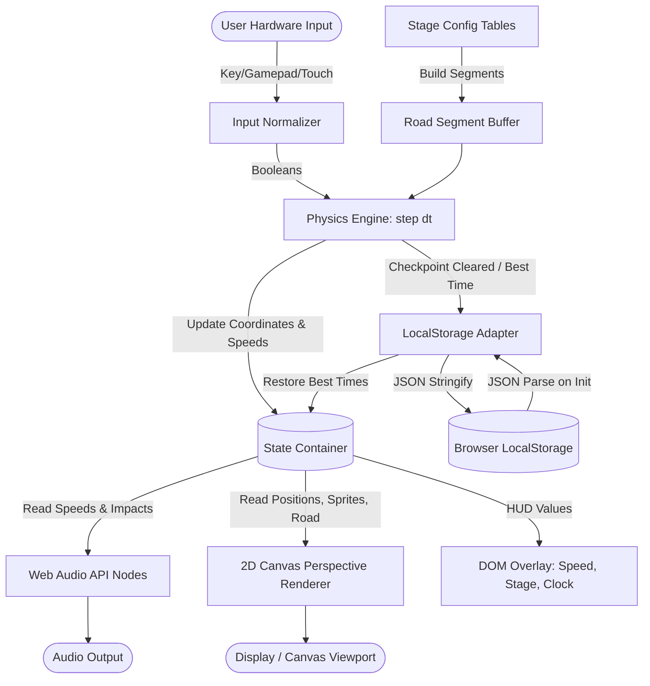

# Data Flow

## 1. Overview
The data flow in "Neon Rush" follows a high-performance game loop architecture:
1. User input events (Keyboard, Gamepad, Touch) are normalized into a single non-allocating `input` state object.
2. A fixed 60Hz physics accumulator processes simulation ticks, advancing car speed, road position, rival AI trajectories, hazard collisions, and checkpoint countdown clocks.
3. Audio synthesis parameters (oscillator frequency, filter cutoff, gain ramps) are updated from physics state changes.
4. Render routines execute every `requestAnimationFrame`, projecting 3D road slices, background parallax skyline, and depth-sorted sprites onto the 2D canvas without mutating state.
5. Record milestones (new stage completed, improved lap time) are serialized and committed to browser `localStorage`.

## 2. System-Level Data Flow

## 3. Authentication Flow
- Not implemented / Not applicable. There is no user login or authentication pipeline in the current project.

## 4. Create Data Flow
- **Stage Initialization**: On stage launch or restart, `ROAD.buildSegments(stageConfig)` creates the segment buffer.
- **Rival Generation**: `STAGE.rivals` are spawned at calibrated longitudinal offsets along the track.
- **Initial Save File Creation**: If `localStorage.getItem("neon_rush_save_data")` returns null, a default record `{ bestTimes: [0,0,0,0,0], highScore: 0, soundMuted: false, version: 1 }` is constructed and persisted.

## 5. Read Data Flow
- At game initialization, the application reads the saved records from `localStorage` inside a guarded `try...catch` block.
- Read values are validated using `Number.isFinite()` and clamped within realistic bounds before population into UI display cards.

## 6. Update Data Flow
- Every physics frame (1/60s), `car.speed` is integrated into `car.z += car.speed * dt`.
- `car.x` is updated by steering rate and curve centrifugal pull: `car.x -= (car.speed / topSpeed) * segment.curve * centrifugal * dt`.
- When `car.z` crosses the track finish threshold, the stage timer is compared against `bestTimes[stageIndex]`. If lower or if previous best was 0, the new record replaces the old record and is written to `localStorage`.

## 7. Delete Flow
- High score and best time records can be reset by clearing the `localStorage` key via the options menu or browser cache clear. In-memory entities are collected by garbage collection when a stage is rebuilt via `reset()`.

## 8. External Services
- No external HTTP APIs, REST endpoints, analytics trackers, or CDNs are contacted. All execution is 100% self-contained and offline-capable.

## 9. File / Storage Flow
- No external file uploads or asset downloads occur. All graphical sprites and audio waves are generated procedurally at runtime.

## 10. Realtime / Background Flow
- Main game loop runs via browser `requestAnimationFrame`.
- Fixed timestep logic accumulator handles up to 5 catch-up sub-steps of 16.67ms to guarantee deterministic physics across variable refresh rate displays (60Hz, 120Hz, 144Hz).
- Page visibility events (`visibilitychange`) automatically pause the physics accumulator and mute audio oscillators to prevent delta spikes.

## 11. Security Boundaries
- All user interaction occurs within the client browser sandbox.
- Local storage operations are constrained by browser same-origin policies.
- No network requests are initiated, preventing any exfiltration risk.

## 12. Important Data Transformations
- **Input Normalization**: Multi-key mappings (ArrowUp, KeyW) and touch press events are collapsed into simple binary flags (`input.up = true`).
- **3D World to 2D Screen Projection**:
  - `scale = camDepth / (segZ - camZ)`
  - `screenX = (canvasWidth / 2) + scale * (worldX - camX) * (canvasWidth / 2)`
  - `screenY = (canvasHeight / 2) - scale * (worldY - camY) * (canvasHeight / 2)`
- **Audio Frequency Mapping**: Car velocity (0 to 12000) is logarithmically mapped to oscillator frequencies (55Hz idle to 380Hz redline).

## 13. Unknown / Unverified Flows
- Remote multiplayer synchronization: Not verified from the current project.
- Remote telemetry or cloud save synchronization: Not verified from the current project.
