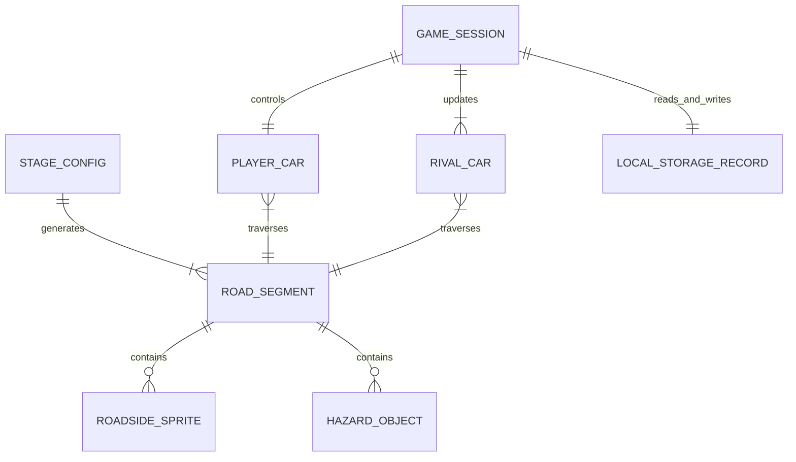

# Data Relationships

## 1. Relationship Overview
The project operates primarily as an in-memory real-time physics and rendering loop with decoupled state. Relationships exist between the Stage configuration, the procedural Road Segments generated from it, the Player Car simulation state, the active Rival Traffic entities, Roadside Sprites/Hazards, and the local browser persistence store (`localStorage`).

## 2. Entity Relationship Diagram

## 3. Relationship Details

### STAGE_CONFIG → ROAD_SEGMENT
- **Relationship**: One-to-Many
- **Foreign Key**: `ROAD_SEGMENT.index` generated sequentially from `STAGE_CONFIG.elements`
- **Cardinality**: 1 Stage Configuration maps to 600 - 1000 contiguous Road Segments.
- **Purpose**: Defines the elevation profiles (hills, valleys) and horizontal curves of the race stage track.

### ROAD_SEGMENT → ROADSIDE_SPRITE
- **Relationship**: One-to-Many (0..N)
- **Foreign Key**: Sprite reference embedded in `segment.sprites` array.
- **Cardinality**: Zero, one, or two roadside sprites (neon skyscrapers, streetlights, neon signs) per segment.
- **Purpose**: Determines lateral offset and depth-scaled rendering order during the perspective road drawing pass.

### ROAD_SEGMENT → HAZARD_OBJECT
- **Relationship**: One-to-One / One-to-Zero
- **Foreign Key**: `segment.hazard` enum (`'slick'` | `'cone'` | `null`).
- **Cardinality**: 0 or 1 hazard per designated segment.
- **Purpose**: Triggers collision response and spin physics when the player vehicle overlaps the segment.

### PLAYER_CAR → ROAD_SEGMENT
- **Relationship**: Many-to-One (active spatial reference)
- **Foreign Key**: `playerSegmentIndex = Math.floor(car.z / segLength) % segments.length`
- **Cardinality**: Exactly 1 active segment references the player's current longitudinal track position at any frame.
- **Purpose**: Provides road curvature, road elevation slope, and road width for physics calculations (centrifugal force, hill pitch).

### RIVAL_CAR → ROAD_SEGMENT
- **Relationship**: Many-to-One
- **Foreign Key**: `rivalSegmentIndex = Math.floor(rival.z / segLength) % segments.length`
- **Cardinality**: Exactly 1 active segment per rival vehicle at any frame.
- **Purpose**: Positions rival vehicles within the 3D projection queue and manages collision bounding boxes with the player.

### GAME_SESSION → LOCAL_STORAGE_RECORD
- **Relationship**: One-to-One
- **Foreign Key**: Key string `"neon_rush_save_data"`
- **Cardinality**: 1 persistence record per browser instance.
- **Purpose**: Loads previous best stage times upon game startup, and updates records when a player completes a stage with an improved time.

## 4. Authentication Relationships
- No authentication identities or user entity mappings exist in the system.

## 5. Ownership Relationships
- **Local Browser Ownership**: The `localStorage` record is owned by the local browser profile.
- **Session Ownership**: All game entities (`CarState`, `RivalCar`, `RoadSegment`) are owned by the active singleton `STATE` container in client memory.

## 6. Dependency Relationships
- **Renderer on State**: `RENDER.draw()` depends strictly on read-only values in `STATE`.
- **Physics on Input**: `PHYSICS.step(dt)` depends on `INPUT` boolean flags.
- **Audio on Physics**: `AUDIO.engine(speed)` depends on `STATE.car.speed`.

## 7. Unverified Relationships
- Backend user profile mappings: Not verified from the current project.
- Global leaderboard or multi-tenant relationships: Not verified from the current project.
